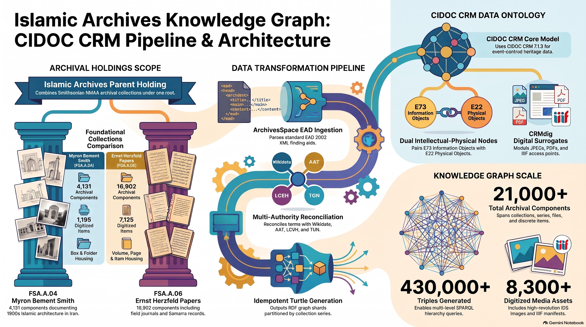
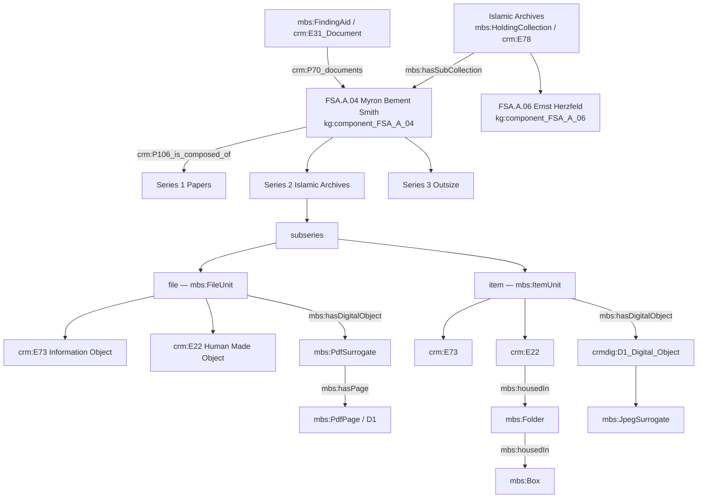
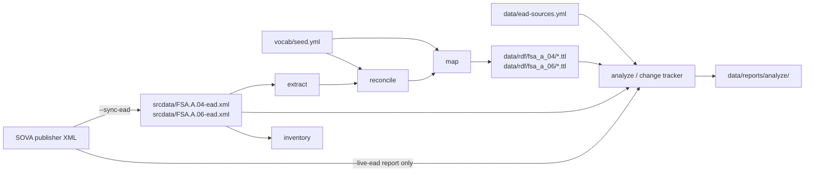
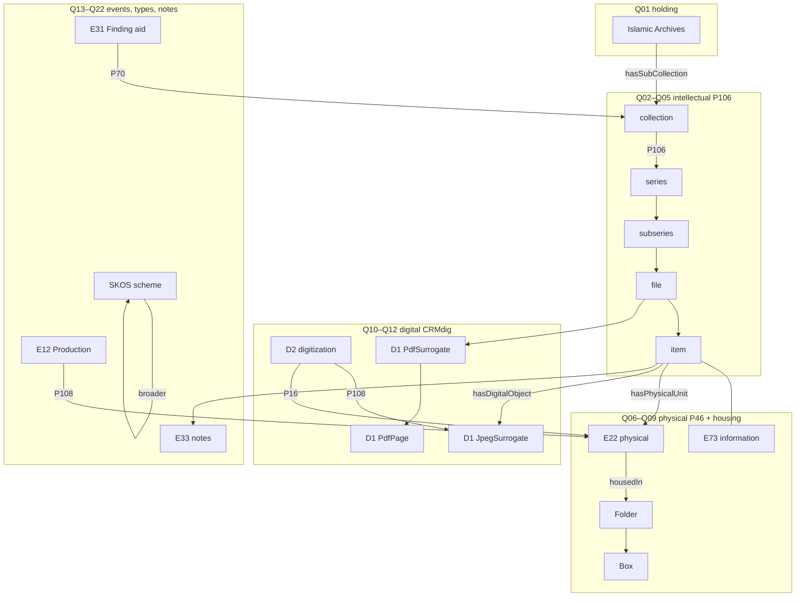

# Islamic Archives Knowledge Graph

[](#scope-of-v2)
[](LICENSE)
[](https://www.cidoc-crm.org/)
[](https://www.cidoc-crm.org/crmdig/)
[](https://www.w3.org/TR/turtle/)
[](https://www.python.org/)
[](https://iiif.io/)
[](vocab/seed.yml)
[](https://sova.si.edu/record/fsa.a.04)
[](https://sova.si.edu/record/fsa.a.06)
[](https://asia.si.edu/research/archives/)
[](#namespaces-and-uris)

CIDOC CRM and OWL knowledge graph of the Smithsonian National Museum of Asian Art **Islamic Archives** holding: the **Myron Bement Smith Collection** ([FSA.A.04](https://sova.si.edu/record/fsa.a.04)) and the **Ernst Herzfeld Papers** ([FSA.A.06](https://sova.si.edu/record/fsa.a.06)), with a shared SKOS control vocabulary for further sibling finding aids.

Sources are ArchivesSpace EAD 2002 files in [`srcdata/`](srcdata/). The graph is Linked Open Data: archival series/file/item trees, physical housing, agents, places, subjects, digitization, and Smithsonian IIIF access points, reconciled to **AAT**, **TGN**, **LCSH/LCNAF**, and **Wikidata**. Each fonds is sharded under `data/rdf/fsa_a_04/` and `data/rdf/fsa_a_06/`. Shared seed entities and concepts live in [`data/rdf/vocabulary.ttl`](data/rdf/vocabulary.ttl); collection shards reference those URIs without duplicating their descriptions.




| Fonds | ARK | SOVA |
| --- | --- | --- |
| Islamic Archives (parent holding) | — | modelled as `kg:collection_islamic_archives` |
| FSA.A.04 Myron Bement Smith | <https://n2t.net/ark:/65665/dc3c8c950fe-250b-40df-b8c7-bcf788073968> | [sova.si.edu/record/fsa.a.04](https://sova.si.edu/record/fsa.a.04) |
| FSA.A.06 Ernst Herzfeld Papers | <https://n2t.net/ark:/65665/dc3d8456fbe-98f6-4159-bd2f-c485379b84a7> | [sova.si.edu/record/fsa.a.06](https://sova.si.edu/record/fsa.a.06) |

## Why the Islamic Archives

Smith (1897–1970) documented Islamic architecture in Iran in the 1930s and spent the rest of his career assembling the **Islamic Archives**: photographs, lantern slides, 35 mm slides, negatives, notebooks, correspondence, and architectural plans covering Iran and the wider Islamic world. Subseries 2.12 of FSA.A.04 holds Antoin Sevruguin’s glass negatives and prints.

Herzfeld (1879–1948) excavated and surveyed Samarra, Persepolis, Pasargadae, and Aleppo. FSA.A.06 holds travel journals, sketchbooks, notebooks, photographic files, drawings and maps, paper squeezes of inscriptions, and the Samarra expedition records — about 150 linear feet.

Both fonds sit under one holding (`mbs:HoldingCollection`). The graph keeps EAD encoding, fills gaps (especially TGN and monument identities), and makes digitization and IIIF queryable across collections. Isolate one fonds in SPARQL with `VALUES ?coll { kg:component_FSA_A_04 }` or `kg:component_FSA_A_06`.

## Ontology

The stored model is **CIDOC CRM 7.1.3 (OWL)** plus **CRMdig**, with a thin application ontology [`ontology/mbs.ttl`](ontology/mbs.ttl).

| Layer | Prefix | Role |
| --- | --- | --- |
| CIDOC CRM 7.1.3 | `crm:` | Things, people, places, time-spans, production, types |
| CRMdig | `crmdig:` | Digitization process and digital surrogates |
| Application profile | `mbs:` | Archival level, box/folder, `digitized` flag, IIIF convenience properties |
| SKOS | `skos:` | Concepts |
| PROV-O | `prov:` | (reserved) reconciliation provenance |
| DCTERMS / RDFS | `dct:` `rdfs:` | Labels and identifiers |

[Records in Contexts (RiC-O)](https://www.ica.org/standards/RiC/ontology) and [Linked Art](https://linked.art/) are alignments, not the native graph. `mbs:ArchivalComponent` is declared `owl:equivalentClass` `rico:RecordSet` so an export is possible later.

CRM is the native model because these fonds are event-centred cultural heritage (making a photograph, field research in Isfahan, Herzfeld’s Samarra excavations, acquiring Sevruguin plates, digitization at the Smithsonian). The archival tree is expressed with CRM composition (`P106` for information objects, `P46` for physical units) plus `mbs:archivalLevel`.

### Two nodes per EAD component

Each series, subseries, file, or item is:

1. an **intellectual** `mbs:ArchivalComponent` (`crm:E73_Information_Object`)
2. a **physical** `mbs:PhysicalComponent` (`crm:E22_Human_Made_Object`)

A glass negative is not the Friday Mosque it depicts. The mosque is a separate `crm:E22` built work, linked with `crm:P67_refers_to` / `crm:P138_represents`, and reconciled to Wikidata (Jameh Mosque of Isfahan `Q1227533`) and AAT mosques (`aat:300007691`).

The EAD document itself is `mbs:FindingAid` / `crm:E31_Document`.



Full field mapping: [`docs/mappings.md`](docs/mappings.md) and [`mappings/ead-to-crm.yml`](mappings/ead-to-crm.yml).

### Box, folder, digitized, IIIF

- `container[@type=Box|Folder]` → `mbs:Box` / `mbs:Folder`. The physical unit `mbs:housedIn` the folder; the folder `mbs:housedIn` the box.
- `mbs:digitized true` **if and only if** the component has an EAD `<dao>`.
- Digitized **`file`** units are PDFs. Access is the EDAN slideshow `https://edan.si.edu/slideshow/viewer/?eadrefid=FSA.A.04_{ref}`. Each PDF page is a separate IDS JPEG with its own IIIF Manifest `https://ids.si.edu/ids/manifest/{page-IDS-ID}` (`mbs:PdfSurrogate` → `mbs:hasPage` → `mbs:PdfPage`). Page IDS ids are harvested (`python -m pipeline.cli slideshow`) or listed in `data/iiif-pages.yml`; until then `mbs:pageManifestsPending true`.
- Digitized **`item`** units are single JPEGs: viewer `https://ids.si.edu/ids/deliveryService?id={ID}` and manifest `https://ids.si.edu/ids/manifest/{ID}` (`mbs:JpegSurrogate`).
- Smithsonian Image API: `https://ids.si.edu/ids/iiif/{ID}`. The pipeline does not invent page IDS identifiers. `--probe-iiif` sets `mbs:iiifResolved` from a live HTTP check.

### Namespaces and URIs

Instance resources use the hash namespace **`kg:`** (`https://w3id.org/sova/fsa_a_04#`) so Turtle serializes prefixed names instead of long angle-bracket IRIs. Local names use underscores (no dots or hyphens), which Ontotext GraphDB can import as prefixed names. CIDOC classes such as `crm:E22_Human_Made_Object` are `owl:equivalentClass` the official hyphenated CRM IRIs.

```turtle
@prefix kg:     <https://w3id.org/sova/fsa_a_04#> .
@prefix mbs:    <https://w3id.org/sova/fsa_a_04/ontology#> .
@prefix crm:    <http://www.cidoc-crm.org/cidoc-crm/> .
@prefix crmdig: <http://www.ics.forth.gr/isl/CRMdig/> .
@prefix lang:   <http://id.loc.gov/vocabulary/iso639-2/> .

kg:event_digitization_fs_fsa_a_04 a crmdig:D2_Digitization_Process ;
    crm:P108_has_produced kg:digital_fs_fsa_a_04 .
```

| Resource | CURIE |
| --- | --- |
| Component | `kg:component_{ead-ref}` |
| Physical unit | `kg:physical_{ead-ref}` |
| Box / folder | `kg:box_{n}` / `kg:folder_{n}_{m}` |
| Agent | `kg:agent_Q{id}` when Wikidata is known |
| Place | `kg:place_tgn_{id}` when TGN is known |
| Linguistic note | `kg:note_{ref}_{ead-element}_{n}` |
| Digital object | `kg:digital_{ids-id}` |
| Islamic Archives (parent holding) | `kg:collection_islamic_archives` |

Smithsonian ARKs remain `owl:sameAs` full IRIs. SOVA pages are `mbs:sovaUrl` / `rdfs:seeAlso` (`https://sova.si.edu/record/fsa.a.04/{ref}`).

### File versus item (media type)

EAD `@level` is not only hierarchy depth. In these finding aids:

- **`file`** (`mbs:FileUnit` / `mbs:DocumentaryFile`) is an aggregating documentary unit — a correspondence folder, a dossier of mixed papers. Typed with AAT *files (document groupings)* (`aat:300027182`).
- **`item`** (`mbs:ItemUnit` / `mbs:DiscreteItem`) is a single resource. Media type is taken from `genreform`, `physdesc/extent@type` (glass negatives, albumen prints, …), or the title (photograph, drawing, notebook, plan).

### Islamic Archives (parent holding)

EAD `corpname` **Islamic Archives** names a larger holding, not a corporate body. FSA.A.04 is one sub-collection of that holding (`kg:collection_islamic_archives` `mbs:hasSubCollection` `kg:component_FSA_A_04`). FSA.A.06 (Ernst Herzfeld Papers) is the sibling branch (`kg:component_FSA_A_06`). Parse and map it with `--ead srcdata/FSA.A.06-ead.xml` (writes `data/rdf/fsa_a_06/`; FSA.A.04 writes `data/rdf/fsa_a_04/`). Shared SKOS stays at `data/rdf/vocabulary.ttl`. Compare local XML to harvested RDF with `python -m pipeline.analyze`.

### Linguistic descriptions

Every EAD prose field — `abstract`, `scopecontent`, `bioghist`, `arrangement`, access/use restrictions, custodial history, `odd`, and related notes — is a `crm:E33_Linguistic_Object` linked by `mbs:hasLinguisticObject`. `langmaterial` becomes `crm:P72_has_language` (`lang:eng`, `lang:fre`, …). Titles are `crm:E35_Title`.

## Source data

Both finding aids are DACS-compliant ArchivesSpace EAD 2002.

**FSA.A.04** Myron Bement Smith (export 2026-10-15):

- **Series 1** Papers (1.1 biographic … 1.8 Katharine Dennis Smith)
- **Series 2** The Islamic Archives (2.1 history … 2.12 Sevruguin photographs)
- **Series 3** Outsize and miscellaneous (map-case, rolled items, freezer, Smithsonian copy negatives)

Housing is almost always Box + Folder; Series 3 also uses Item, Roll, Oversize, Map-rolled.

**FSA.A.06** Ernst Herzfeld Papers:

- **Series 1** Travel Journals
- **Series 2** Sketchbooks
- **Series 3** Notebooks
- **Series 4** Photographic Files
- **Series 5** Drawings and Maps
- **Series 6** Paper Squeezes of Inscriptions
- **Series 7** Records of Samarra Expeditions

Housing is Volume / Page / Item (no Box/Folder). Sketchbooks use EDAN `damspath=` slideshows (`mbs:edan_damspath`) as well as IDS JPEGs and a few `eadrefid` slideshows.

Levels used in both: `collection`, `series`, `subseries`, `file`, `item`.

Authority encoding already in the EAD (uneven):

- Wikidata Q-ids on many `persname` values
- LCSH / LCNAF on subjects and some places (mix of full URIs and bare labels)
- AAT on `genreform`. EAD “Glass negatives” is mapped to wet collodion negatives (`aat:300134674`), with generic glass negatives (`aat:300010898`) as SKOS broader and dry collodion (`aat:300241140`) as related.
- **No TGN** in the source — spatial enhancement is a pipeline goal
- Inline `persname` / `geogname` in titles (Masjid-i Jomeh, Isfahan, Palmyra, Samarra, …) are harvested in addition to `<controlaccess>`

Digitization appears as:

1. Direct IDS images, e.g. Sevruguin `https://ids.si.edu/ids/deliveryService?id=FS-FSA_A.4_2.12.GN.00.02-000004`
2. EDAN slideshows by `eadrefid`, e.g. Masjid-i Jomeh `https://edan.si.edu/slideshow/viewer/?eadrefid=FSA.A.04_ref7856`
3. EDAN slideshows by `damspath` (Herzfeld sketchbooks), e.g. `https://edan.si.edu/slideshow/slideshowViewer.htm?damspath=/Public_Sets/FS/FSA/FSA_A.06_02.01.01`

## Pipeline



### Change tracker

The change tracker compares local harvest data with the EAD XML the original publisher currently serves. Collections to watch are listed as filename stems in [`data/ead-sources.yml`](data/ead-sources.yml):

```yaml
sources:
  - FSA.A.04-ead
  - FSA.A.06-ead
```

Each stem is `srcdata/<stem>.xml`. The ArchivesSpace id is the stem without `-ead` (`FSA.A.04-ead` → FSA.A.04). Publisher URLs default to `https://sova.si.edu/record/<eadid>.xml`. Add another sibling by appending one stem.

**1. Compare and report only** — fetch SOVA XML into `vocab/cache/ead-remote/`, diff it against `srcdata/`, and write `data/reports/analyze/`. Local EAD and RDF stay unchanged.

```powershell
python -m pipeline.analyze --live-ead
python -m pipeline.cli analyze --live-ead
python -m pipeline.analyze --live-ead --ead srcdata/FSA.A.06-ead.xml
python -m pipeline.analyze --live-ead --refresh-ead
```

**2. Download the updated EAD and sync RDF** — re-fetch publisher XML, copy it onto `srcdata/` when the bytes differ (previous file kept under `vocab/cache/ead-local-backup/`), and remap that collection’s Turtle shards. `--sync-ead` implies `--live-ead` and `--refresh-ead`.

```powershell
python -m pipeline.analyze --sync-ead
python -m pipeline.cli analyze --sync-ead
python -m pipeline.analyze --sync-ead --ead srcdata/FSA.A.04-ead.xml
```

Reports: [`data/reports/analyze/report.md`](data/reports/analyze/report.md), `summary.json`, and per-collection `FSA_A_04.json` / `FSA_A_06.json`. `compare_remote` is the publisher-vs-local diff (added/removed/changed components, DAO hrefs, finding-aid creation date). `compare_rdf` is local EAD vs harvested RDF. Offline `python -m pipeline.analyze` (no flags) is the RDF integrity check only.

`--sync-ead` remaps from the updated XML using the existing reconciliation cache. If the publisher added names that need seed matches, run `extract`, `reconcile`, and `map` afterwards. New EDAN slideshows still need `python -m pipeline.cli slideshow`.

## Repository layout

```
srcdata/FSA.A.04-ead.xml     EAD source of truth (Myron Bement Smith)
srcdata/FSA.A.06-ead.xml     Sibling EAD (Ernst Herzfeld Papers; map with --ead)
ontology/mbs.ttl             Local OWL application profile
ontology/catalog.ttl         Prefix / import catalog
mappings/ead-to-crm.yml      Machine mapping table
docs/mappings.md             Human mapping + Turtle examples
pipeline/                    Python transform
vocab/seed.yml               High-confidence AAT/TGN/LCSH/Wikidata seeds
vocab/cache/                 Extracted entities + reconciliation (generated)
data/rdf/vocabulary.ttl      Shared SKOS scheme
data/rdf/fsa_a_04/*.ttl      FSA.A.04 CRM graph (generated)
data/rdf/fsa_a_06/*.ttl      FSA.A.06 CRM graph (generated)
data/reports/                Inventory, analyze, and SHACL reports
data/ead-sources.yml         Change-tracker source list (FSA.A.04-ead, FSA.A.06-ead)
shapes/mbs.shacl.ttl         SHACL
queries/*.rq                 SPARQL catalog (22 hierarchy queries)
tests/test_parser.py         Parser / IIIF / analyze smoke tests
```

## Install and run

Python 3.10+ from the repository root:

```powershell
python -m venv .venv
.\.venv\Scripts\Activate.ps1
pip install -r requirements.txt
```

```powershell
python -m pipeline.cli all
```

Stages (any one can be run alone):

| Stage | Command | Output |
| --- | --- | --- |
| Inventory | `python -m pipeline.cli inventory` | `data/reports/inventory.json` |
| Extract | `python -m pipeline.cli extract` | `vocab/cache/entities.json` |
| Reconcile | `python -m pipeline.cli reconcile` | `vocab/cache/reconciled.json` |
| Shared vocabulary | `python -m pipeline.cli vocab` | `data/rdf/vocabulary.ttl` |
| Map to CRM | `python -m pipeline.cli map` | `data/rdf/fsa_a_04/*.ttl` (use `--ead` for A.06) |
| Slideshow pages | `python -m pipeline.cli slideshow` | `vocab/cache/slideshow-pages.json` |
| Change tracker | `python -m pipeline.analyze` / `--live-ead` / `--sync-ead` | `data/reports/analyze/` |
| SHACL | `python -m pipeline.cli validate` | `data/reports/shacl-report.txt` |

Optional flags:

- `--live` — call Getty SPARQL for places still unmatched (default is **offline**: EAD URIs + `vocab/seed.yml`)
- `--probe-iiif` — HTTP-check derived IIIF `info.json` / manifest URLs
- `--fetch-slideshow` — harvest per-page IDS ids from EDAN slideshow HTML
- `--limit N` — map only the first N components (useful while developing)
- `--ead path` — finding aid XML (default `srcdata/FSA.A.04-ead.xml` → `data/rdf/fsa_a_04/`; FSA.A.06 → `data/rdf/fsa_a_06/`)
- `--live-ead` — change tracker mode 1: fetch published SOVA XML and report diffs against `srcdata/` (cache `vocab/cache/ead-remote/`; does not overwrite EAD or RDF). Sources: [`data/ead-sources.yml`](data/ead-sources.yml)
- `--sync-ead` — change tracker mode 2: download publisher EAD into `srcdata/` when it changed and remap that collection’s RDF
- `--refresh-ead` — re-download cached remote EAD XML (implied by `--sync-ead`)

Smoke tests:

```powershell
python tests/test_parser.py
```

## Run GraphDB with Docker

With Docker Desktop running, start GraphDB from the repository root. The named volume keeps the database when the container is stopped or replaced.

```powershell
docker run -d --name graphdb `
  -p 7200:7200 `
  -v graphdb-data:/opt/graphdb/home `
  ontotext/graphdb:latest
```

Open [http://localhost:7200](http://localhost:7200) and create a repository in GraphDB Workbench (for example, `islamic_archives`). For a straightforward load without inferred statements, choose the `None` ruleset.

In Workbench, open **Import → RDF** and upload these Turtle files to that repository:

1. `ontology/mbs.ttl`
2. `data/rdf/vocabulary.ttl`
3. Every `*.ttl` file in `data/rdf/fsa_a_04/` and `data/rdf/fsa_a_06/`

Import the files into the default graph (leave the named graph unset). Importing the ontology and shared vocabulary alongside both fonds makes the application classes and referenced concepts available to queries. The checked-in RDF can be loaded as-is; run the pipeline first only if you want to regenerate it from the EAD sources.

To confirm the load, run this in the Workbench SPARQL editor:

```sparql
SELECT (COUNT(*) AS ?triples) WHERE { ?s ?p ?o }
```

Then try [`queries/01-holding-subcollections.rq`](queries/01-holding-subcollections.rq). Stop and restart the container without losing its repository data with `docker stop graphdb` and `docker start graphdb`.

## Reconciliation

1. Keep every `@authfilenumber` already in the EAD (Wikidata Q-ids, `id.loc.gov`, `vocab.getty.edu/aat`).
2. Match labels against [`vocab/seed.yml`](vocab/seed.yml), the shared Islamic Archives control vocabulary (AAT, TGN, LCSH, LCNAF, Wikidata, Iconclass). `python -m pipeline.cli vocab` writes `data/rdf/vocabulary.ttl` idempotently. `skos:broader` is for local seed parents; `skos:broadMatch` is for external parents.
   Seeded `crm:E21_Person`, `crm:E74_Group`, `crm:E53_Place`, and `crm:E55_Type` descriptions are emitted only in `data/rdf/vocabulary.ttl`; collection and series shards retain references to their stable seed URIs. Agent seed rows default to people; use `kind: group` for corporate bodies.
3. Harvest inline names in titles and notes, not only `<controlaccess>`.
4. Write a reviewable cache under `vocab/cache/` so rebuilds are deterministic.
5. Unmatched strings remain first-class local resources (`mbs:sourceString`).

`--live` is additive and conservative. It does not overwrite seed or EAD URIs.

## SPARQL: walking the hierarchy

Load `ontology/mbs.ttl`, `data/rdf/vocabulary.ttl`, and `data/rdf/fsa_a_04/*.ttl` plus `data/rdf/fsa_a_06/*.ttl`. Prefixed CRM names use underscores (`crm:P106_is_composed_of`). The catalog is [`queries/`](queries/README.md) (22 numbered files). This diagram is the same tree those queries traverse.

### Collection Level
```sparql
PREFIX kg:   <https://w3id.org/sova/fsa_a_04#>
PREFIX crm:  <http://www.cidoc-crm.org/cidoc-crm/>
PREFIX rdfs: <http://www.w3.org/2000/01/rdf-schema#>

SELECT distinct ?coll ?type WHERE {

  ?coll mbs:archivalLevel "collection" ;
      a ?type.
}
```
### Hierarchy of Containers
```sparql
PREFIX mbs:    <https://w3id.org/sova/fsa_a_04/ontology#>
PREFIX crmdig: <http://www.ics.forth.gr/isl/CRMdig/>
PREFIX kg:   <https://w3id.org/sova/fsa_a_04#>
PREFIX crm:  <http://www.cidoc-crm.org/cidoc-crm/>
PREFIX rdfs: <http://www.w3.org/2000/01/rdf-schema#>

SELECT ?level (COUNT(?c) AS ?n) WHERE {
  kg:component_FSA_A_06 crm:P106_is_composed_of+ ?c .
  ?c mbs:archivalLevel ?level .
}
GROUP BY ?level
```

### Deep Walking
```sparql
PREFIX mbs:    <https://w3id.org/sova/fsa_a_04/ontology#>
PREFIX crmdig: <http://www.ics.forth.gr/isl/CRMdig/>
PREFIX kg:   <https://w3id.org/sova/fsa_a_04#>
PREFIX crm:  <http://www.cidoc-crm.org/cidoc-crm/>
PREFIX rdfs: <http://www.w3.org/2000/01/rdf-schema#>

SELECT ?c ?level ?title ?d1 ?storage ?storageType WHERE {
  kg:component_FSA_A_04 crm:P106_is_composed_of+ ?c .
  ?c mbs:archivalLevel ?level ; rdfs:label ?title .
  OPTIONAL {
    ?c mbs:hasDigitalObject ?d1 .
    ?d1 a crmdig:D1_Digital_Object .
  }
  OPTIONAL {
    ?c mbs:hasPhysicalUnit ?phys .
    ?phys mbs:housedIn+ ?storage .
    ?storage a ?storageType .
  }
}

Limit 100
```

### Reverse Navigation
```sparql
PREFIX mbs:    <https://w3id.org/sova/fsa_a_04/ontology#>
PREFIX crmdig: <http://www.ics.forth.gr/isl/CRMdig/>
PREFIX kg:   <https://w3id.org/sova/fsa_a_04#>
PREFIX crm:  <http://www.cidoc-crm.org/cidoc-crm/>
PREFIX rdfs: <http://www.w3.org/2000/01/rdf-schema#>

SELECT ?coll ?c ?phys ?folder ?box WHERE {
  BIND(kg:digital_fs_fsa_a_4_2_12_gn_07_05 AS ?d1)
  ?d1 (crm:P70i_is_documented_in | ^mbs:hasPage / crm:P70i_is_documented_in) ?c .
  ?coll a mbs:ArchivalComponent ;
        mbs:archivalLevel "collection" ;
        crm:P106_is_composed_of* ?c .
  OPTIONAL {
    ?c mbs:hasPhysicalUnit ?phys .
    OPTIONAL { ?phys mbs:housedIn ?folder . ?folder a mbs:Folder }
    OPTIONAL { ?phys mbs:housedIn+ ?box . ?box a mbs:Box }
  }
}
```



### 01. Holding and sub-collections

```sparql
PREFIX kg:   <https://w3id.org/sova/fsa_a_04#>
PREFIX mbs:  <https://w3id.org/sova/fsa_a_04/ontology#>
PREFIX rdfs: <http://www.w3.org/2000/01/rdf-schema#>

SELECT ?holding ?holdingLabel ?sub ?subLabel ?eadRef WHERE {
  ?holding a mbs:HoldingCollection ; rdfs:label ?holdingLabel ;
           mbs:hasSubCollection ?sub .
  ?sub rdfs:label ?subLabel .
  OPTIONAL { ?sub mbs:eadRef ?eadRef }
}
```

[`queries/01-holding-subcollections.rq`](queries/01-holding-subcollections.rq)

### 02. Collection composed of series

```sparql
PREFIX mbs:  <https://w3id.org/sova/fsa_a_04/ontology#>
PREFIX crm:  <http://www.cidoc-crm.org/cidoc-crm/>
PREFIX rdfs: <http://www.w3.org/2000/01/rdf-schema#>

SELECT ?collection ?series ?title ?eadRef WHERE {
  ?collection mbs:archivalLevel "collection" ;
              crm:P106_is_composed_of ?series .
  ?series mbs:archivalLevel "series" ; rdfs:label ?title ; mbs:eadRef ?eadRef .
}
```

[`queries/02-collection-series.rq`](queries/02-collection-series.rq)

### 03. Full path collection → series → subseries → file → item

```sparql
PREFIX mbs:  <https://w3id.org/sova/fsa_a_04/ontology#>
PREFIX crm:  <http://www.cidoc-crm.org/cidoc-crm/>
PREFIX rdfs: <http://www.w3.org/2000/01/rdf-schema#>

SELECT ?collectionTitle ?seriesTitle ?subTitle ?fileTitle ?itemTitle WHERE {
  ?collection mbs:archivalLevel "collection" ; rdfs:label ?collectionTitle ;
              crm:P106_is_composed_of ?series .
  ?series mbs:archivalLevel "series" ; rdfs:label ?seriesTitle ;
          crm:P106_is_composed_of ?sub .
  ?sub mbs:archivalLevel "subseries" ; rdfs:label ?subTitle .
  OPTIONAL {
    ?sub crm:P106_is_composed_of ?file .
    ?file mbs:archivalLevel "file" ; rdfs:label ?fileTitle .
    OPTIONAL {
      ?file crm:P106_is_composed_of ?item .
      ?item mbs:archivalLevel "item" ; rdfs:label ?itemTitle .
    }
  }
}
LIMIT 200
```

[`queries/03-hierarchy-path.rq`](queries/03-hierarchy-path.rq)

### 04. All descendants of Series 2 (`P106+`)

```sparql
PREFIX kg:   <https://w3id.org/sova/fsa_a_04#>
PREFIX mbs:  <https://w3id.org/sova/fsa_a_04/ontology#>
PREFIX crm:  <http://www.cidoc-crm.org/cidoc-crm/>

SELECT ?level (COUNT(?c) AS ?n) WHERE {
  kg:component_ref7426 crm:P106_is_composed_of+ ?c .
  ?c mbs:archivalLevel ?level .
}
GROUP BY ?level
```

[`queries/04-descendants-of-series.rq`](queries/04-descendants-of-series.rq)

### 05. Direct parent / child

[`queries/05-parent-child.rq`](queries/05-parent-child.rq) — `mbs:hasChildComponent` with archival levels.

### 06. Intellectual E73 + physical E22 pair

```sparql
PREFIX mbs:  <https://w3id.org/sova/fsa_a_04/ontology#>
PREFIX crm:  <http://www.cidoc-crm.org/cidoc-crm/>
PREFIX rdfs: <http://www.w3.org/2000/01/rdf-schema#>

SELECT ?intel ?level ?title ?phys WHERE {
  ?intel a mbs:ArchivalComponent , crm:E73_Information_Object ;
         mbs:archivalLevel ?level ; rdfs:label ?title ;
         mbs:hasPhysicalUnit ?phys .
  ?phys a mbs:PhysicalComponent , crm:E22_Human_Made_Object .
}
LIMIT 50
```

[`queries/06-intellectual-physical.rq`](queries/06-intellectual-physical.rq)

### 07. FileUnit vs ItemUnit

[`queries/07-file-vs-item.rq`](queries/07-file-vs-item.rq)

### 08. Box → folder → physical unit

```sparql
PREFIX mbs:  <https://w3id.org/sova/fsa_a_04/ontology#>
PREFIX rdfs: <http://www.w3.org/2000/01/rdf-schema#>

SELECT ?boxNo ?folderNo ?title WHERE {
  ?component a mbs:ArchivalComponent ; rdfs:label ?title ;
             mbs:hasPhysicalUnit ?phys .
  ?phys mbs:housedIn ?folder .
  ?folder a mbs:Folder ; mbs:folderNumber ?folderNo ;
          mbs:housedIn ?box .
  ?box a mbs:Box ; mbs:boxNumber ?boxNo .
}
ORDER BY ?boxNo ?folderNo
LIMIT 100
```

[`queries/08-box-folder-housing.rq`](queries/08-box-folder-housing.rq)

### 09. Physical `P46` tree

[`queries/09-physical-composition.rq`](queries/09-physical-composition.rq)

### 10. Item JPEG D1 + IIIF Manifest

```sparql
PREFIX mbs:    <https://w3id.org/sova/fsa_a_04/ontology#>
PREFIX crmdig: <http://www.ics.forth.gr/isl/CRMdig/>
PREFIX rdfs:   <http://www.w3.org/2000/01/rdf-schema#>

SELECT ?title ?d1 ?manifest WHERE {
  ?component a mbs:ItemUnit ; mbs:digitized true ; rdfs:label ?title ;
             mbs:hasDigitalObject ?d1 .
  ?d1 a crmdig:D1_Digital_Object , mbs:JpegSurrogate .
  OPTIONAL { ?d1 mbs:iiifManifest ?manifest }
}
LIMIT 100
```

[`queries/10-jpeg-surrogates.rq`](queries/10-jpeg-surrogates.rq)

### 11. File PDF surrogate → page D1

[`queries/11-pdf-pages.rq`](queries/11-pdf-pages.rq) — `mbs:PdfSurrogate` `mbs:hasPage` `mbs:PdfPage` with a IIIF Manifest per page.

### 12. D2 digitization process

[`queries/12-digitization-process.rq`](queries/12-digitization-process.rq) — `crmdig:D2` `P108_has_produced` D1 and `P16_used_specific_object` the physical unit.

### 13. Production event and time-span

[`queries/13-production-timespan.rq`](queries/13-production-timespan.rq)

### 14. Wet collodion / glass negatives

[`queries/14-glass-negatives.rq`](queries/14-glass-negatives.rq) — physical `P2_has_type` `kg:concept_aat_300134674`.

### 15. SKOS broader tree

[`queries/15-skos-tree.rq`](queries/15-skos-tree.rq) — local `skos:broader` inside `kg:scheme_islamic_archives`.

### 16. Photograph represents a built work

[`queries/16-built-works.rq`](queries/16-built-works.rq) — `crm:P138_represents` a mosque `E22` (the negative is not the building).

### 17. Finding aid documents the collection

[`queries/17-finding-aid.rq`](queries/17-finding-aid.rq)

### 18. Undigitized components still in the tree

[`queries/18-undigitized.rq`](queries/18-undigitized.rq)

### 19. Scope-content linguistic objects

[`queries/19-linguistic-notes.rq`](queries/19-linguistic-notes.rq)

### 20. Languages on notes (`P72`)

[`queries/20-languages.rq`](queries/20-languages.rq)

### 21. Sevruguin glass under Series 2

[`queries/21-sevruguin-glass.rq`](queries/21-sevruguin-glass.rq)

### 22. Census by archival level and D1 coverage

[`queries/22-counts-by-level.rq`](queries/22-counts-by-level.rq)

Also: [`queries/masjid.rq`](queries/masjid.rq), [`queries/boxes-architectural.rq`](queries/boxes-architectural.rq), [`queries/agents-wikidata.rq`](queries/agents-wikidata.rq), [`queries/digitized-by-place.rq`](queries/digitized-by-place.rq), [`queries/vocabulary.rq`](queries/vocabulary.rq), [`queries/digitized-access.rq`](queries/digitized-access.rq).

## Generated RDF files

| File | Contents | Triples |
| --- | --- | --- |
| `data/rdf/vocabulary.ttl` | Shared Islamic Archives SKOS scheme | (seed) |
| `data/rdf/fsa_a_04/collection.ttl` | FSA.A.04 collection, finding aid, Islamic Archives holding | ~620 |
| `data/rdf/fsa_a_04/series-1.ttl` | Series 1 Papers | 62,944 |
| `data/rdf/fsa_a_04/series-2.ttl` | Series 2 Islamic Archives | 365,241 |
| `data/rdf/fsa_a_04/series-3.ttl` | Series 3 outsize / miscellaneous | 4,108 |
| `data/rdf/fsa_a_06/collection.ttl` | FSA.A.06 collection, finding aid, Islamic Archives holding | — |
| `data/rdf/fsa_a_06/series-1.ttl` … `series-7.ttl` | Herzfeld series 1–7 | — |

Agents, places, and concepts are written into the series file that first mentions them. Rebuild time is a few minutes (`python -m pipeline.cli map`).

Current inventory (`python -m pipeline.cli inventory` and `python -m pipeline.analyze`):

**FSA.A.04** (`data/rdf/fsa_a_04/`; EAD components missing from RDF: 0; digitized without D1: 0)

| | Count |
| --- | --- |
| Components | 4131 |
| collection / series / subseries / file / item | 1 / 3 / 132 / 625 / 3370 |
| Digitized (`dao` present) | 1195 (895 IDS images, 334 EDAN slideshows) |
| Not digitized | 2936 |
| Components with ARK | 4131 (all) |
| Distinct boxes | 234 |
| Named entities with URI / without | 6692 / 7080 |
| RDF triples (collection + 3 series) | 432,913 |
| FileUnit / ItemUnit | 625 / 3,370 |

Housing in FSA.A.04: Box, Folder, Oversize, Roll, Map-rolled, Item.

**FSA.A.06** Ernst Herzfeld Papers (mapped under `data/rdf/fsa_a_06/`)

| | Count |
| --- | --- |
| Components | 16,902 |
| collection / series / subseries / file / item | 1 / 7 / 70 / 1071 / 15,753 |
| Digitized | 7125 (7229 IDS images, 99 damspath slideshows, 13 eadrefid slideshows) |
| Not digitized | 9777 |
| Named mentions with URI / without | 65,707 / 23,072 |
| Unseeded label types (seed.yml candidates) | 322 |

Housing in FSA.A.06 is Volume / Page / Item (not Box/Folder). Digital access adds EDAN `damspath=` slideshows (`mbs:edan_damspath`) alongside IDS JPEGs.

Full per-collection diff: [`data/reports/analyze/report.md`](data/reports/analyze/report.md).

## Licence and citation

- **Code** in this repository: [GNU GPL v3](LICENSE).
- **Finding aid text and archival metadata**: Smithsonian / National Museum of Asian Art Archives. Permission to publish, quote, or reproduce collection materials must be secured from the repository ([FSA.A.04 conditions](https://sova.si.edu/record/fsa.a.04), [FSA.A.06 conditions](https://sova.si.edu/record/fsa.a.06)).
- **Many Smithsonian digital images** are released under CC0; check the object page. This project stores URIs, not image binaries.

Preferred citations:

> The Myron Bement Smith Collection, FSA.A.04. National Museum of Asian Art Archives. Smithsonian Institution, Washington, D.C. Gift of Katharine Dennis Smith.

> Ernst Herzfeld Papers, FSA.A.06. National Museum of Asian Art Archives. Smithsonian Institution, Washington, D.C. Gift of Ernst Herzfeld, 1946.

Finding aid authors: Dr. Elizabeth Graves (FSA.A.04, 2015); Joseph M. Upton and Colleen Hennessey (FSA.A.06). Other related SOVA collections (Bier, Sevruguin albums) remain textual `relatedmaterial` notes until their EAD is added as further sub-collections of the Islamic Archives.

## Scope of v2

**v1** mapped a single fonds (FSA.A.04) as a standalone knowledge graph.

**v2** treats the Islamic Archives as the parent holding and maps every documented sibling under the same CIDOC CRM / CRMdig profile, shared SKOS scheme, and per-collection RDF shards.

In scope:

- Full EAD parse and CRM mapping of **FSA.A.04** and **FSA.A.06**
- Parent holding `kg:collection_islamic_archives` (`mbs:HoldingCollection` / `crm:E78`)
- Shared vocabulary [`vocab/seed.yml`](vocab/seed.yml) → [`data/rdf/vocabulary.ttl`](data/rdf/vocabulary.ttl)
- Physical housing: Box/Folder (Smith) and Volume/Page/Item (Herzfeld)
- `crmdig:D1_Digital_Object` for IDS JPEGs, EDAN `eadrefid` slideshows, and EDAN `damspath` slideshows, with IIIF Manifests
- Change tracker (`python -m pipeline.analyze --live-ead` report-only; `--sync-ead` download and remap)
- SPARQL catalog for the intellectual `P106` tree, housing, and D1 surrogates
- Layout ready for further NMAA Islamic Archives siblings (`data/rdf/<eadid-slug>/`)

Out of scope: OCR, computer vision, a hosted SPARQL endpoint, rewriting Smithsonian manifests, mapping collections that are only named in `relatedmaterial` (Bier, extra Sevruguin albums) until their EAD is ingested.
