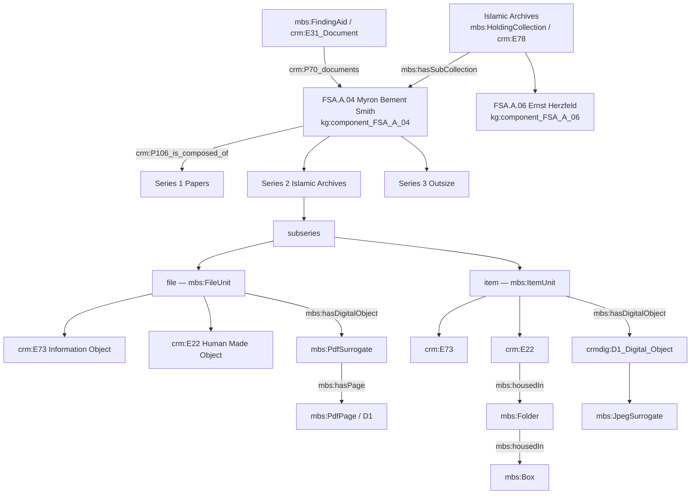
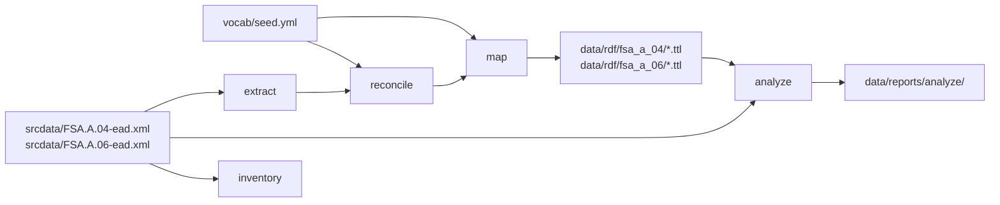
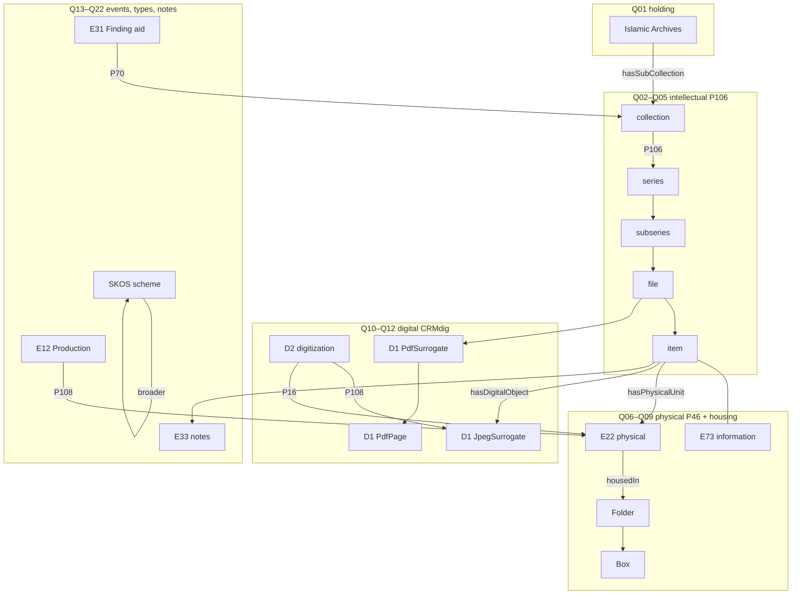

# Myron Bement Smith Collection Knowledge Graph

CIDOC CRM and OWL knowledge graph of the **Myron Bement Smith Collection** (Smithsonian National Museum of Asian Art Archives, identifier **FSA.A.04**).

The source is the ArchivesSpace EAD 2002 finding aid in [`srcdata/FSA.A.04-ead.xml`](srcdata/FSA.A.04-ead.xml). The public hierarchical rendering of the same data is [SOVA FSA.A.04](https://sova.si.edu/record/fsa-a-04). This repository turns that finding aid into Linked Open Data: archival box/folder structure, agents, places, subjects, a digitization flag, and Smithsonian IIIF access points, reconciled to **AAT**, **TGN**, **LCSH/LCNAF**, and **Wikidata**.

Collection ARK: <https://n2t.net/ark:/65665/dc3c8c950fe-250b-40df-b8c7-bcf788073968>

## Why this collection

Smith (1897–1970) documented Islamic architecture in Iran in the 1930s and spent the rest of his career building the **Islamic Archives**: photographs, lantern slides, 35 mm slides, negatives, notebooks, correspondence, and architectural plans covering Iran and the wider Islamic world. Subseries 2.12 holds Antoin Sevruguin’s glass negatives and prints. The finding aid already carries a minimum of agent, date, place, and topical encoding. The graph keeps that encoding, fills gaps (especially TGN and monument identities), and makes digitization and IIIF queryable.

## Ontology

The stored model is **CIDOC CRM 7.1.3 (OWL)** plus **CRMdig**, with a thin application ontology [`ontology/mbs.ttl`](ontology/mbs.ttl).

| Layer | Prefix | Role |
| --- | --- | --- |
| CIDOC CRM 7.1.3 | `crm:` | Things, people, places, time-spans, production, types |
| CRMdig | `crmdig:` | Digitization process and digital surrogates |
| Application profile | `mbs:` | Archival level, box/folder, `digitized` flag, IIIF convenience properties |
| SKOS | `skos:` | Concepts |
| PROV-O | `prov:` | (reserved) reconciliation provenance |
| DCTERMS / RDFS | `dct:` `rdfs:` | Labels and identifiers |

[Records in Contexts (RiC-O)](https://www.ica.org/standards/RiC/ontology) and [Linked Art](https://linked.art/) are alignments, not the native graph. `mbs:ArchivalComponent` is declared `owl:equivalentClass` `rico:RecordSet` so an export is possible later.

CRM is the native model because the collection is event-centred cultural heritage (making a photograph, field research in Isfahan, acquiring Sevruguin plates, digitization at the Smithsonian). The archival tree is expressed with CRM composition (`P106` for information objects, `P46` for physical units) plus `mbs:archivalLevel`.

### Two nodes per EAD component

Each series, subseries, file, or item is:

1. an **intellectual** `mbs:ArchivalComponent` (`crm:E73_Information_Object`)
2. a **physical** `mbs:PhysicalComponent` (`crm:E22_Human_Made_Object`)

A glass negative is not the Friday Mosque it depicts. The mosque is a separate `crm:E22` built work, linked with `crm:P67_refers_to` / `crm:P138_represents`, and reconciled to Wikidata (Jameh Mosque of Isfahan `Q1227533`) and AAT mosques (`aat:300007691`).

The EAD document itself is `mbs:FindingAid` / `crm:E31_Document`.



Full field mapping: [`docs/mappings.md`](docs/mappings.md) and [`mappings/ead-to-crm.yml`](mappings/ead-to-crm.yml).

### Box, folder, digitized, IIIF

- `container[@type=Box|Folder]` → `mbs:Box` / `mbs:Folder`. The physical unit `mbs:housedIn` the folder; the folder `mbs:housedIn` the box.
- `mbs:digitized true` **if and only if** the component has an EAD `<dao>`.
- Digitized **`file`** units are PDFs. Access is the EDAN slideshow `https://edan.si.edu/slideshow/viewer/?eadrefid=FSA.A.04_{ref}`. Each PDF page is a separate IDS JPEG with its own IIIF Manifest `https://ids.si.edu/ids/manifest/{page-IDS-ID}` (`mbs:PdfSurrogate` → `mbs:hasPage` → `mbs:PdfPage`). Page IDS ids are harvested (`python -m pipeline.cli slideshow`) or listed in `data/iiif-pages.yml`; until then `mbs:pageManifestsPending true`.
- Digitized **`item`** units are single JPEGs: viewer `https://ids.si.edu/ids/deliveryService?id={ID}` and manifest `https://ids.si.edu/ids/manifest/{ID}` (`mbs:JpegSurrogate`).
- Smithsonian Image API: `https://ids.si.edu/ids/iiif/{ID}`. The pipeline does not invent page IDS identifiers. `--probe-iiif` sets `mbs:iiifResolved` from a live HTTP check.

### Namespaces and URIs

Instance resources use the hash namespace **`kg:`** (`https://w3id.org/sova/fsa_a_04#`) so Turtle serializes prefixed names instead of long angle-bracket IRIs. Local names use underscores (no dots or hyphens), which Ontotext GraphDB can import as prefixed names. CIDOC classes such as `crm:E22_Human_Made_Object` are `owl:equivalentClass` the official hyphenated CRM IRIs.

```turtle
@prefix kg:     <https://w3id.org/sova/fsa_a_04#> .
@prefix mbs:    <https://w3id.org/sova/fsa_a_04/ontology#> .
@prefix crm:    <http://www.cidoc-crm.org/cidoc-crm/> .
@prefix crmdig: <http://www.ics.forth.gr/isl/CRMdig/> .
@prefix lang:   <http://id.loc.gov/vocabulary/iso639-2/> .

kg:event_digitization_fs_fsa_a_04 a crmdig:D2_Digitization_Process ;
    crm:P108_has_produced kg:digital_fs_fsa_a_04 .
```

| Resource | CURIE |
| --- | --- |
| Component | `kg:component_{ead-ref}` |
| Physical unit | `kg:physical_{ead-ref}` |
| Box / folder | `kg:box_{n}` / `kg:folder_{n}_{m}` |
| Agent | `kg:agent_Q{id}` when Wikidata is known |
| Place | `kg:place_tgn_{id}` when TGN is known |
| Linguistic note | `kg:note_{ref}_{ead-element}_{n}` |
| Digital object | `kg:digital_{ids-id}` |
| Islamic Archives (parent holding) | `kg:collection_islamic_archives` |

Smithsonian ARKs remain `owl:sameAs` full IRIs. SOVA pages are `mbs:sovaUrl` / `rdfs:seeAlso` (`https://sova.si.edu/record/fsa.a.04/{ref}`).

### File versus item (media type)

EAD `@level` is not only hierarchy depth. In this collection:

- **`file`** (`mbs:FileUnit` / `mbs:DocumentaryFile`) is an aggregating documentary unit — a correspondence folder, a dossier of mixed papers. Typed with AAT *files (document groupings)* (`aat:300027182`).
- **`item`** (`mbs:ItemUnit` / `mbs:DiscreteItem`) is a single resource. Media type is taken from `genreform`, `physdesc/extent@type` (glass negatives, albumen prints, …), or the title (photograph, drawing, notebook, plan).

### Islamic Archives (parent holding)

EAD `corpname` **Islamic Archives** names a larger holding, not a corporate body. FSA.A.04 is one sub-collection of that holding (`kg:collection_islamic_archives` `mbs:hasSubCollection` `kg:component_FSA_A_04`). FSA.A.06 (Ernst Herzfeld Papers) is the sibling branch (`kg:component_FSA_A_06`). Parse and map it with `--ead srcdata/FSA.A.06-ead.xml` (writes `data/rdf/fsa_a_06/`; FSA.A.04 writes `data/rdf/fsa_a_04/`). Shared SKOS stays at `data/rdf/vocabulary.ttl`. Compare local XML to harvested RDF with `python -m pipeline.analyze`.

### Linguistic descriptions

Every EAD prose field — `abstract`, `scopecontent`, `bioghist`, `arrangement`, access/use restrictions, custodial history, `odd`, and related notes — is a `crm:E33_Linguistic_Object` linked by `mbs:hasLinguisticObject`. `langmaterial` becomes `crm:P72_has_language` (`lang:eng`, `lang:fre`, …). Titles are `crm:E35_Title`.

## Source data

The EAD is DACS-compliant, produced in ArchivesSpace (export dated 2026-10-15). Structure:

- **Series 1** Papers (1.1 biographic … 1.8 Katharine Dennis Smith)
- **Series 2** The Islamic Archives (2.1 history … 2.12 Sevruguin photographs)
- **Series 3** Outsize and miscellaneous (map-case, rolled items, freezer, Smithsonian copy negatives)

Levels used: `collection`, `series`, `subseries`, `file`, `item`. Housing is almost always Box + Folder; Series 3 also uses Item locations.

Authority encoding already in the EAD (uneven):

- Wikidata Q-ids on many `persname` values
- LCSH / LCNAF on subjects and some places (mix of full URIs and bare labels)
- AAT on `genreform`. EAD “Glass negatives” is mapped to wet collodion negatives (`aat:300134674`), with generic glass negatives (`aat:300010898`) as SKOS broader and dry collodion (`aat:300241140`) as related.
- **No TGN** in the source — spatial enhancement is a pipeline goal
- Inline `persname` / `geogname` in titles (Masjid-i Jomeh, Isfahan, Palmyra, …) are harvested in addition to `<controlaccess>`

Digitization appears as:

1. Direct IDS images, e.g. Sevruguin `https://ids.si.edu/ids/deliveryService?id=FS-FSA_A.4_2.12.GN.00.02-000004`
2. EDAN slideshows, e.g. Masjid-i Jomeh folder `https://edan.si.edu/slideshow/viewer/?eadrefid=FSA.A.04_ref7856`

## Pipeline



## Repository layout

```
srcdata/FSA.A.04-ead.xml     EAD source of truth (Myron Bement Smith)
srcdata/FSA.A.06-ead.xml     Sibling EAD (Ernst Herzfeld Papers; map with --ead)
ontology/mbs.ttl             Local OWL application profile
ontology/catalog.ttl         Prefix / import catalog
mappings/ead-to-crm.yml      Machine mapping table
docs/mappings.md             Human mapping + Turtle examples
pipeline/                    Python transform
vocab/seed.yml               High-confidence AAT/TGN/LCSH/Wikidata seeds
vocab/cache/                 Extracted entities + reconciliation (generated)
data/rdf/vocabulary.ttl      Shared SKOS scheme
data/rdf/fsa_a_04/*.ttl      FSA.A.04 CRM graph (generated)
data/rdf/fsa_a_06/*.ttl      FSA.A.06 CRM graph (generated)
data/reports/                Inventory, analyze, and SHACL reports
data/ead-sources.yml         Local + live SOVA XML locations
shapes/mbs.shacl.ttl         SHACL
queries/*.rq                 SPARQL catalog (22 hierarchy queries)
tests/test_parser.py         Parser / IIIF / analyze smoke tests
```

## Install and run

Python 3.10+ from the repository root:

```powershell
python -m venv .venv
.\.venv\Scripts\Activate.ps1
pip install -r requirements.txt
```

```powershell
python -m pipeline.cli all
```

Stages (any one can be run alone):

| Stage | Command | Output |
| --- | --- | --- |
| Inventory | `python -m pipeline.cli inventory` | `data/reports/inventory.json` |
| Extract | `python -m pipeline.cli extract` | `vocab/cache/entities.json` |
| Reconcile | `python -m pipeline.cli reconcile` | `vocab/cache/reconciled.json` |
| Shared vocabulary | `python -m pipeline.cli vocab` | `data/rdf/vocabulary.ttl` |
| Map to CRM | `python -m pipeline.cli map` | `data/rdf/fsa_a_04/*.ttl` (use `--ead` for A.06) |
| Slideshow pages | `python -m pipeline.cli slideshow` | `vocab/cache/slideshow-pages.json` |
| Analyze EAD vs RDF | `python -m pipeline.cli analyze` or `python -m pipeline.analyze` | `data/reports/analyze/` |
| SHACL | `python -m pipeline.cli validate` | `data/reports/shacl-report.txt` |

Optional flags:

- `--live` — call Getty SPARQL for places still unmatched (default is **offline**: EAD URIs + `vocab/seed.yml`)
- `--probe-iiif` — HTTP-check derived IIIF `info.json` / manifest URLs
- `--fetch-slideshow` — harvest per-page IDS ids from EDAN slideshow HTML
- `--limit N` — map only the first N components (useful while developing)
- `--ead path` — finding aid XML (default `srcdata/FSA.A.04-ead.xml` → `data/rdf/fsa_a_04/`; FSA.A.06 → `data/rdf/fsa_a_06/`)
- `--live-ead` — with `analyze`, fetch published SOVA XML and diff it against `srcdata/` (cached under `vocab/cache/ead-remote/`; does not overwrite source EAD or RDF)
- `--refresh-ead` — re-download cached remote EAD XML

Smoke tests:

```powershell
python tests/test_parser.py
```

## Reconciliation

1. Keep every `@authfilenumber` already in the EAD (Wikidata Q-ids, `id.loc.gov`, `vocab.getty.edu/aat`).
2. Match labels against [`vocab/seed.yml`](vocab/seed.yml), the shared Islamic Archives control vocabulary (AAT, TGN, LCSH, LCNAF, Wikidata, Iconclass). `python -m pipeline.cli vocab` writes `data/rdf/vocabulary.ttl` idempotently. `skos:broader` is for local seed parents; `skos:broadMatch` is for external parents.
3. Harvest inline names in titles and notes, not only `<controlaccess>`.
4. Write a reviewable cache under `vocab/cache/` so rebuilds are deterministic.
5. Unmatched strings remain first-class local resources (`mbs:sourceString`).

`--live` is additive and conservative. It does not overwrite seed or EAD URIs.

## SPARQL: walking the hierarchy

Load `ontology/mbs.ttl`, `data/rdf/vocabulary.ttl`, and `data/rdf/fsa_a_04/*.ttl` plus `data/rdf/fsa_a_06/*.ttl`. Prefixed CRM names use underscores (`crm:P106_is_composed_of`). The catalog is [`queries/`](queries/README.md) (22 numbered files). This diagram is the same tree those queries traverse.



### 01. Holding and sub-collections

```sparql
PREFIX kg:   <https://w3id.org/sova/fsa_a_04#>
PREFIX mbs:  <https://w3id.org/sova/fsa_a_04/ontology#>
PREFIX rdfs: <http://www.w3.org/2000/01/rdf-schema#>

SELECT ?holding ?holdingLabel ?sub ?subLabel ?eadRef WHERE {
  ?holding a mbs:HoldingCollection ; rdfs:label ?holdingLabel ;
           mbs:hasSubCollection ?sub .
  ?sub rdfs:label ?subLabel .
  OPTIONAL { ?sub mbs:eadRef ?eadRef }
}
```

[`queries/01-holding-subcollections.rq`](queries/01-holding-subcollections.rq)

### 02. Collection composed of series

```sparql
PREFIX mbs:  <https://w3id.org/sova/fsa_a_04/ontology#>
PREFIX crm:  <http://www.cidoc-crm.org/cidoc-crm/>
PREFIX rdfs: <http://www.w3.org/2000/01/rdf-schema#>

SELECT ?collection ?series ?title ?eadRef WHERE {
  ?collection mbs:archivalLevel "collection" ;
              crm:P106_is_composed_of ?series .
  ?series mbs:archivalLevel "series" ; rdfs:label ?title ; mbs:eadRef ?eadRef .
}
```

[`queries/02-collection-series.rq`](queries/02-collection-series.rq)

### 03. Full path collection → series → subseries → file → item

```sparql
PREFIX mbs:  <https://w3id.org/sova/fsa_a_04/ontology#>
PREFIX crm:  <http://www.cidoc-crm.org/cidoc-crm/>
PREFIX rdfs: <http://www.w3.org/2000/01/rdf-schema#>

SELECT ?collectionTitle ?seriesTitle ?subTitle ?fileTitle ?itemTitle WHERE {
  ?collection mbs:archivalLevel "collection" ; rdfs:label ?collectionTitle ;
              crm:P106_is_composed_of ?series .
  ?series mbs:archivalLevel "series" ; rdfs:label ?seriesTitle ;
          crm:P106_is_composed_of ?sub .
  ?sub mbs:archivalLevel "subseries" ; rdfs:label ?subTitle .
  OPTIONAL {
    ?sub crm:P106_is_composed_of ?file .
    ?file mbs:archivalLevel "file" ; rdfs:label ?fileTitle .
    OPTIONAL {
      ?file crm:P106_is_composed_of ?item .
      ?item mbs:archivalLevel "item" ; rdfs:label ?itemTitle .
    }
  }
}
LIMIT 200
```

[`queries/03-hierarchy-path.rq`](queries/03-hierarchy-path.rq)

### 04. All descendants of Series 2 (`P106+`)

```sparql
PREFIX kg:   <https://w3id.org/sova/fsa_a_04#>
PREFIX mbs:  <https://w3id.org/sova/fsa_a_04/ontology#>
PREFIX crm:  <http://www.cidoc-crm.org/cidoc-crm/>

SELECT ?level (COUNT(?c) AS ?n) WHERE {
  kg:component_ref7426 crm:P106_is_composed_of+ ?c .
  ?c mbs:archivalLevel ?level .
}
GROUP BY ?level
```

[`queries/04-descendants-of-series.rq`](queries/04-descendants-of-series.rq)

### 05. Direct parent / child

[`queries/05-parent-child.rq`](queries/05-parent-child.rq) — `mbs:hasChildComponent` with archival levels.

### 06. Intellectual E73 + physical E22 pair

```sparql
PREFIX mbs:  <https://w3id.org/sova/fsa_a_04/ontology#>
PREFIX crm:  <http://www.cidoc-crm.org/cidoc-crm/>
PREFIX rdfs: <http://www.w3.org/2000/01/rdf-schema#>

SELECT ?intel ?level ?title ?phys WHERE {
  ?intel a mbs:ArchivalComponent , crm:E73_Information_Object ;
         mbs:archivalLevel ?level ; rdfs:label ?title ;
         mbs:hasPhysicalUnit ?phys .
  ?phys a mbs:PhysicalComponent , crm:E22_Human_Made_Object .
}
LIMIT 50
```

[`queries/06-intellectual-physical.rq`](queries/06-intellectual-physical.rq)

### 07. FileUnit vs ItemUnit

[`queries/07-file-vs-item.rq`](queries/07-file-vs-item.rq)

### 08. Box → folder → physical unit

```sparql
PREFIX mbs:  <https://w3id.org/sova/fsa_a_04/ontology#>
PREFIX rdfs: <http://www.w3.org/2000/01/rdf-schema#>

SELECT ?boxNo ?folderNo ?title WHERE {
  ?component a mbs:ArchivalComponent ; rdfs:label ?title ;
             mbs:hasPhysicalUnit ?phys .
  ?phys mbs:housedIn ?folder .
  ?folder a mbs:Folder ; mbs:folderNumber ?folderNo ;
          mbs:housedIn ?box .
  ?box a mbs:Box ; mbs:boxNumber ?boxNo .
}
ORDER BY ?boxNo ?folderNo
LIMIT 100
```

[`queries/08-box-folder-housing.rq`](queries/08-box-folder-housing.rq)

### 09. Physical `P46` tree

[`queries/09-physical-composition.rq`](queries/09-physical-composition.rq)

### 10. Item JPEG D1 + IIIF Manifest

```sparql
PREFIX mbs:    <https://w3id.org/sova/fsa_a_04/ontology#>
PREFIX crmdig: <http://www.ics.forth.gr/isl/CRMdig/>
PREFIX rdfs:   <http://www.w3.org/2000/01/rdf-schema#>

SELECT ?title ?d1 ?manifest WHERE {
  ?component a mbs:ItemUnit ; mbs:digitized true ; rdfs:label ?title ;
             mbs:hasDigitalObject ?d1 .
  ?d1 a crmdig:D1_Digital_Object , mbs:JpegSurrogate .
  OPTIONAL { ?d1 mbs:iiifManifest ?manifest }
}
LIMIT 100
```

[`queries/10-jpeg-surrogates.rq`](queries/10-jpeg-surrogates.rq)

### 11. File PDF surrogate → page D1

[`queries/11-pdf-pages.rq`](queries/11-pdf-pages.rq) — `mbs:PdfSurrogate` `mbs:hasPage` `mbs:PdfPage` with a IIIF Manifest per page.

### 12. D2 digitization process

[`queries/12-digitization-process.rq`](queries/12-digitization-process.rq) — `crmdig:D2` `P108_has_produced` D1 and `P16_used_specific_object` the physical unit.

### 13. Production event and time-span

[`queries/13-production-timespan.rq`](queries/13-production-timespan.rq)

### 14. Wet collodion / glass negatives

[`queries/14-glass-negatives.rq`](queries/14-glass-negatives.rq) — physical `P2_has_type` `kg:concept_aat_300134674`.

### 15. SKOS broader tree

[`queries/15-skos-tree.rq`](queries/15-skos-tree.rq) — local `skos:broader` inside `kg:scheme_islamic_archives`.

### 16. Photograph represents a built work

[`queries/16-built-works.rq`](queries/16-built-works.rq) — `crm:P138_represents` a mosque `E22` (the negative is not the building).

### 17. Finding aid documents the collection

[`queries/17-finding-aid.rq`](queries/17-finding-aid.rq)

### 18. Undigitized components still in the tree

[`queries/18-undigitized.rq`](queries/18-undigitized.rq)

### 19. Scope-content linguistic objects

[`queries/19-linguistic-notes.rq`](queries/19-linguistic-notes.rq)

### 20. Languages on notes (`P72`)

[`queries/20-languages.rq`](queries/20-languages.rq)

### 21. Sevruguin glass under Series 2

[`queries/21-sevruguin-glass.rq`](queries/21-sevruguin-glass.rq)

### 22. Census by archival level and D1 coverage

[`queries/22-counts-by-level.rq`](queries/22-counts-by-level.rq)

Also: [`queries/masjid.rq`](queries/masjid.rq), [`queries/boxes-architectural.rq`](queries/boxes-architectural.rq), [`queries/agents-wikidata.rq`](queries/agents-wikidata.rq), [`queries/digitized-by-place.rq`](queries/digitized-by-place.rq), [`queries/vocabulary.rq`](queries/vocabulary.rq), [`queries/digitized-access.rq`](queries/digitized-access.rq).

## Generated RDF files

| File | Contents | Triples |
| --- | --- | --- |
| `data/rdf/vocabulary.ttl` | Shared Islamic Archives SKOS scheme | (seed) |
| `data/rdf/fsa_a_04/collection.ttl` | FSA.A.04 collection, finding aid, Islamic Archives holding | ~620 |
| `data/rdf/fsa_a_04/series-1.ttl` | Series 1 Papers | 62,944 |
| `data/rdf/fsa_a_04/series-2.ttl` | Series 2 Islamic Archives | 365,241 |
| `data/rdf/fsa_a_04/series-3.ttl` | Series 3 outsize / miscellaneous | 4,108 |
| `data/rdf/fsa_a_06/collection.ttl` | FSA.A.06 collection, finding aid, Islamic Archives holding | — |
| `data/rdf/fsa_a_06/series-1.ttl` … `series-7.ttl` | Herzfeld series 1–7 | — |

Agents, places, and concepts are written into the series file that first mentions them. Rebuild time is a few minutes (`python -m pipeline.cli map`).

Current inventory (`python -m pipeline.cli inventory` and `python -m pipeline.analyze`):

**FSA.A.04** (`data/rdf/fsa_a_04/`; EAD components missing from RDF: 0; digitized without D1: 0)

| | Count |
| --- | --- |
| Components | 4131 |
| collection / series / subseries / file / item | 1 / 3 / 132 / 625 / 3370 |
| Digitized (`dao` present) | 1195 (895 IDS images, 334 EDAN slideshows) |
| Not digitized | 2936 |
| Components with ARK | 4131 (all) |
| Distinct boxes | 234 |
| Named entities with URI / without | 6692 / 7080 |
| RDF triples (collection + 3 series) | 432,913 |
| FileUnit / ItemUnit | 625 / 3,370 |

Housing in FSA.A.04: Box, Folder, Oversize, Roll, Map-rolled, Item.

**FSA.A.06** Ernst Herzfeld Papers (mapped under `data/rdf/fsa_a_06/`)

| | Count |
| --- | --- |
| Components | 16,902 |
| collection / series / subseries / file / item | 1 / 7 / 70 / 1071 / 15,753 |
| Digitized | 7125 (7229 IDS images, 99 damspath slideshows, 13 eadrefid slideshows) |
| Not digitized | 9777 |
| Named mentions with URI / without | 65,707 / 23,072 |
| Unseeded label types (seed.yml candidates) | 322 |

Housing in FSA.A.06 is Volume / Page / Item (not Box/Folder). Digital access adds EDAN `damspath=` slideshows (`mbs:edan_damspath`) alongside IDS JPEGs.

Full per-collection diff: [`data/reports/analyze/report.md`](data/reports/analyze/report.md).

## Licence and citation

- **Code** in this repository: [GNU GPL v3](LICENSE).
- **Finding aid text and archival metadata**: Smithsonian / National Museum of Asian Art Archives. Permission to publish, quote, or reproduce collection materials must be secured from the repository ([conditions of use](https://sova.si.edu/record/fsa-a-04)).
- **Many Smithsonian digital images** are released under CC0; check the object page. This project stores URIs, not image binaries.

Preferred citation of the collection:

> The Myron Bement Smith Collection, FSA A.04. National Museum of Asian Art Archives. Smithsonian Institution, Washington, D.C. Gift of Katharine Dennis Smith.

Finding aid author: Dr. Elizabeth Graves (2015). The Ernst Herzfeld Papers (FSA.A.06) are a sibling sub-collection of the Islamic Archives (`kg:component_FSA_A_06`); map them with `--ead srcdata/FSA.A.06-ead.xml`. Other related SOVA collections (Bier, Sevruguin albums) remain textual `relatedmaterial` notes.

## Scope of v1

In scope: full EAD parse of FSA.A.04 and FSA.A.06, CRM mapping of FSA.A.04, box/folder (and Herzfeld Volume/Page/Item in the analyzer), digitized flag, derived IIIF URIs, seed reconciliation to AAT/TGN/LCSH/Wikidata, idempotent EAD-vs-RDF analysis, SHACL, SPARQL catalog, public README.

Out of scope: OCR, computer vision, a hosted SPARQL endpoint, rewriting Smithsonian manifests.
