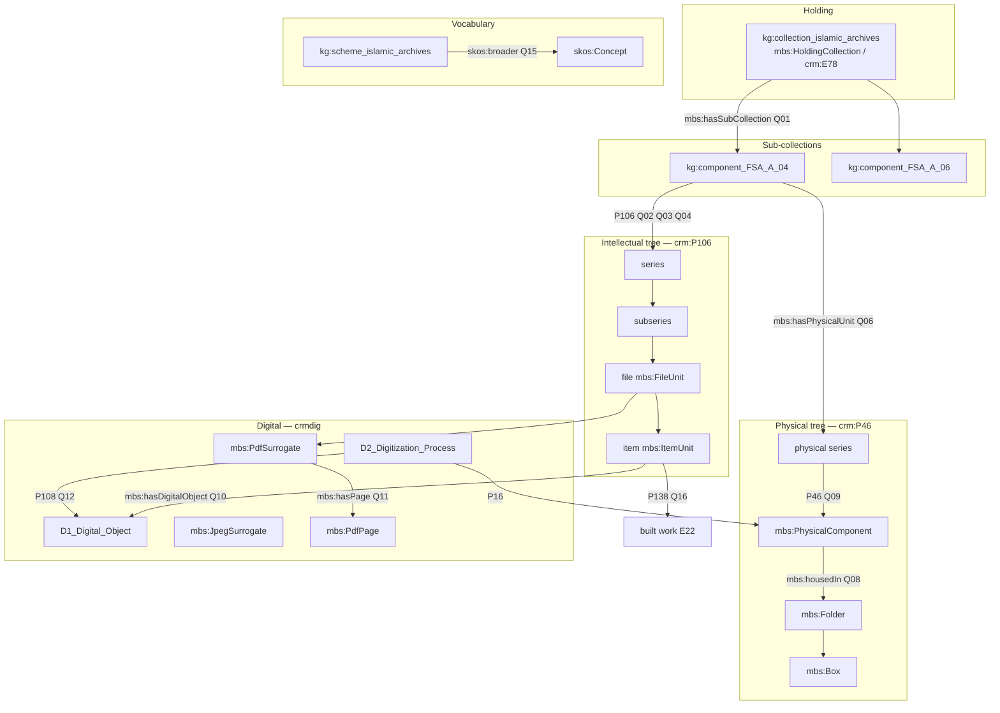

# SPARQL catalog

Load `ontology/mbs.ttl`, `data/rdf/vocabulary.ttl`, `data/rdf/fsa_a_04/*.ttl`, and `data/rdf/fsa_a_06/*.ttl` into GraphDB, Oxigraph, or Fuseki. Local names use underscores (`crm:P106_is_composed_of`, `crm:E22_Human_Made_Object`). Isolate one fonds with `VALUES ?coll { kg:component_FSA_A_04 }` (or `kg:component_FSA_A_06`).

The diagram is the queryable tree. Each numbered query walks one slice of it.

| # | File | Walks |
| --- | --- | --- |
| 01 | [01-holding-subcollections.rq](01-holding-subcollections.rq) | Holding → FSA.A.04 / FSA.A.06 |
| 02 | [02-collection-series.rq](02-collection-series.rq) | Collection → series |
| 03 | [03-hierarchy-path.rq](03-hierarchy-path.rq) | collection → series → subseries → file → item |
| 04 | [04-descendants-of-series.rq](04-descendants-of-series.rq) | `P106+` descendants of Series 2 |
| 05 | [05-parent-child.rq](05-parent-child.rq) | `mbs:hasChildComponent` |
| 06 | [06-intellectual-physical.rq](06-intellectual-physical.rq) | E73 + E22 pair |
| 07 | [07-file-vs-item.rq](07-file-vs-item.rq) | FileUnit vs ItemUnit |
| 08 | [08-box-folder-housing.rq](08-box-folder-housing.rq) | Box → folder → physical |
| 09 | [09-physical-composition.rq](09-physical-composition.rq) | `P46` physical tree |
| 10 | [10-jpeg-surrogates.rq](10-jpeg-surrogates.rq) | Item D1 JPEG + IIIF |
| 11 | [11-pdf-pages.rq](11-pdf-pages.rq) | File PDF → page D1 |
| 12 | [12-digitization-process.rq](12-digitization-process.rq) | D2 used physical, produced D1 |
| 13 | [13-production-timespan.rq](13-production-timespan.rq) | E12 + E52 |
| 14 | [14-glass-negatives.rq](14-glass-negatives.rq) | Wet collodion type |
| 15 | [15-skos-tree.rq](15-skos-tree.rq) | Local `skos:broader` |
| 16 | [16-built-works.rq](16-built-works.rq) | `P138_represents` mosque |
| 17 | [17-finding-aid.rq](17-finding-aid.rq) | E31 documents collection |
| 18 | [18-undigitized.rq](18-undigitized.rq) | No dao / no D1 |
| 19 | [19-linguistic-notes.rq](19-linguistic-notes.rq) | Scope content E33 |
| 20 | [20-languages.rq](20-languages.rq) | `P72` languages |
| 21 | [21-sevruguin-glass.rq](21-sevruguin-glass.rq) | Series 2 Sevruguin D1 |
| 22 | [22-counts-by-level.rq](22-counts-by-level.rq) | Census by level |

Earlier aliases (`islamic-archives.rq`, `masjid.rq`, `digitized-access.rq`, …) remain for the same graph.
